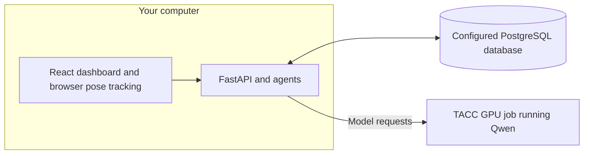

# Run FitPilot locally with TACC Qwen

Install the app dependencies and choose a database using the [local setup guide](../../README.md#getting-started-instructions). MediaPipe analyzes video in the browser. FastAPI runs the five agents and connects to PostgreSQL using `DATABASE_URL`. A GPU job in the CSIT6000V public Project environment serves `qwen3.8-27b` for model requests.



## 1. Set up the course SDK

Use Bash for the commands below. Start in the FitPilot repository root and remember its path.

```bash
bash
FITPILOT_ROOT=$(pwd -P)
```

Reuse the `tcloud` SDK from Assignment 1 if you already have it. The course sample specifies v0.4.1 downloads for [Linux x86_64](https://github.com/turingaicloud/quickstart/releases/download/v0.4.1/linux-amd64-v0.4.1.zip) and [Intel macOS](https://github.com/turingaicloud/quickstart/releases/download/v0.4.1/macos-amd64-v0.4.1.zip). Extract the matching download and add the directory containing `tcloud` to this terminal's `PATH`. [Official SDK release](https://github.com/turingaicloud/quickstart/releases/tag/v0.4.1)

```bash
FITPILOT_TCLOUD_DIR='/absolute/path/to/extracted-sdk'
chmod +x "$FITPILOT_TCLOUD_DIR/tcloud"
export PATH="$FITPILOT_TCLOUD_DIR:$PATH"
tcloud --help
```

If you extracted the Intel SDK into Downloads, use `export PATH="$HOME/Downloads/macos-amd64-v0.4.1:$PATH"`. The help command ran with that executable on the Apple Silicon Mac used for this project. The course sample directs students on Apple Silicon or Windows to ask the teaching assistant for a supported client.

For a new SDK account configuration, use your assigned username and the private key for the public key you registered with the course. Keep the key in your SSH directory.

```bash
tcloud config -u YOUR_USERNAME -f /path/to/your/private_key
tcloud init
tcloud env ls
```

If your SDK is already configured, use `tcloud ps` to check scheduler access. Ask the teaching assistant about account initialization or cluster connection errors that persist with your course configuration. [Official SDK configuration](https://github.com/turingaicloud/tcloud-sdk#configuration)

## 2. Register the public Project environment

Run `tcloud env ls -n proxy`. If `proxy` is already registered for your course account, go to step 3. The FitPilot service job in this repository activates the shared course model runtime on TACC.

If the environment is missing, get `project-release-1.zip` from the course Project materials. Set the archive path below to wherever you downloaded it. The archive is needed for initial course account setup.

Create a new local work directory outside the repository for the extracted sample, staged job, and downloaded results. Keep these variables in the same Bash session.

```bash
mkdir -p "$HOME/fitpilot-tacc"
FITPILOT_TACC_RUN=$(mktemp -d "$HOME/fitpilot-tacc/run.XXXXXXXX")
FITPILOT_COURSE_ZIP='/absolute/path/to/project-release-1.zip'
unzip -q "$FITPILOT_COURSE_ZIP" -d "$FITPILOT_TACC_RUN/course-sample"
cd "$FITPILOT_TACC_RUN/course-sample/qwen27b-student-release"
bash setup-sdk-account.sh
```

Set `FITPILOT_COURSE_ZIP` to the actual absolute download path if the archive is elsewhere. The extracted `README.md` and `STUDENT-COMMANDS.md` cover course account setup and troubleshooting. The setup script registers the course `proxy` environment. An existing private empty `proxy` also works with the service launcher: the course activation script explicitly selects the public Python/vLLM runtime. If the setup script refuses an existing private environment, retain it and submit the service directly; do not delete an environment used by other work. FitPilot's jobs use that environment and then activate the public Project runtime. You can check registration with `tcloud env ls -n proxy`. If the SDK reports `EnvironmentLocationNotFound`, run the setup script before submitting a job.

## 3. Submit the GPU service

```bash
cd "$FITPILOT_ROOT/backend/tacc/serve"
tcloud submit
```

Set `SERVICE_JOB_ID` to the numeric ID returned by the SDK.

```bash
SERVICE_JOB_ID=YOUR_SERVICE_JOB_ID
tcloud ps -j "$SERVICE_JOB_ID"
tcloud cat "slurm_log/fitpilot-qwen-serve-${SERVICE_JOB_ID}.log"
```

The job requests one node, two GPUs, eight CPUs, and up to one hour. Wait for `Application startup complete` in the log. The first startup can take more than ten minutes while vLLM loads and compiles the model. Copy the value after `SERVICE_BASE_URL=` from that job and keep its `/v1` suffix. The address changes across service jobs. For TACC nodes named with four hyphenated IPv4 octets, the launcher prints the dotted private address because the course Python runtime may be unable to resolve the hostname. [SDK job configuration](https://github.com/turingaicloud/tcloud-sdk#job-configuration)

## 4. Connect your local app

FastAPI needs a network route to the current Qwen endpoint. The course service URL is on the cluster network. Scheduler access through `tcloud ps` and model reachability from your computer are separate checks.

### Through the configured TACC gateway

If your TACC gateway permits TCP forwarding, start FitPilot with the running service job ID. The launcher reads the job address and the gateway configured in your local `tcloud` SDK. It uses OpenSSH with host key verification to forward Qwen to `127.0.0.1:18000`. The browser talks to the local FastAPI process on port `8000`.

```bash
cd "$FITPILOT_ROOT"
env -u DATABASE_URL -u DATABASE_URL_UNPOOLED python3.11 scripts/dev.py --tacc-job "$SERVICE_JOB_ID"
```

If the SDK is outside `PATH`, add `--tcloud /absolute/path/to/tcloud`. If port `18000` is occupied, select a free port with `--tacc-port`. Ctrl+C stops the local app and closes the SSH connection. Use step 5 to stop the GPU job. When the GPU job ends, the dashboard stays available but model-dependent requests fail until a new reachable service is configured.

The launcher requires an existing SDK account with one SSH gateway, a key available for noninteractive authentication, and a verified gateway host key. If the gateway rejects forwarding, ask course staff for a reachable endpoint or supported network route. [TACC access FAQ](https://github.com/turingaicloud/quickstart/blob/master/FAQ.md#4-can-i-ssh-to-the-tcloud-server)

### Through a directly reachable endpoint

If your computer already has a route to Qwen, set the reachable model URL in your private `backend/.env`. Keep the `/v1` suffix and leave `LLM_BASE_URL` empty so the backend selects the course Qwen configuration.

```dotenv
QWEN_BASE_URL=http://REACHABLE_QWEN_ADDRESS:8000/v1
QWEN_MODEL=qwen3.8-27b
```

Use the address and port for your connection. Start the app from the repository root using the [launch command](../../README.md#open-the-app).

### Verify the local API connection

Sign in to the [dashboard](http://127.0.0.1:5173), then open [model status](http://127.0.0.1:5173/api/model/status) in the same browser. When the response shows `"reachable": true`, return to the dashboard and run an agent. FitPilot sends relevant context to Qwen, including saved pose measurements for exercise feedback. Video frames and pose inference stay in the browser.

## Optional validation inside TACC

The CPU job checks model calls and plan validation from inside the cluster with a seeded synthetic profile. It produces diagnostic JSON for course testing. The local dashboard uses the GPU service through its FastAPI backend independently of this validation job.

### Stage and submit the validation job

Stage the client in the run directory from step 2 using Python 3.9 or newer. At the prompt, paste the service URL copied from the log. The prompt keeps the address out of the command history. The stager copies the runtime source and catalog files to a new directory and writes the current address to its private `server-url.txt`.

```bash
FITPILOT_URL_FILE=$(mktemp "$FITPILOT_TACC_RUN/service-url.XXXXXXXX")
read -r -s -p 'Paste the current SERVICE_BASE_URL, including /v1: ' FITPILOT_SERVICE_URL
printf '\n'
printf '%s\n' "$FITPILOT_SERVICE_URL" > "$FITPILOT_URL_FILE"
unset FITPILOT_SERVICE_URL
python3 "$FITPILOT_ROOT/scripts/prepare_tacc_client.py" \
  --service-url-file "$FITPILOT_URL_FILE" \
  --output "$FITPILOT_TACC_RUN/client"
```

The output directory must be new and outside the repository. The staging directory contains the batch entry point, the FitPilot backend code it needs, and the Postgres schema/seed files. The job requires `DATABASE_URL` (and `psycopg`) in the CPU runtime, creates a disposable schema, runs with UTC week boundaries, then drops the schema. Keep Neon credentials out of the repository; pass them through the job environment.

Keep the GPU service running and submit the CPU job from the staged directory.

```bash
cd "$FITPILOT_TACC_RUN/client"
tcloud submit
```

Set `CLIENT_JOB_ID` to the numeric ID returned by the second submission.

```bash
CLIENT_JOB_ID=YOUR_CLIENT_JOB_ID
tcloud ps -j "$CLIENT_JOB_ID"
tcloud cat "slurm_log/fitpilot-qwen-client-${CLIENT_JOB_ID}.log"
```

The CPU job requests one CPU and up to 15 minutes. It invokes the same goal, exercise, nutrition, movement feedback, and evaluation agents as the application. It requires Pydantic `>=2.8,<3` in the course `qwen-python` runtime. If the runtime reports that this requirement is missing, ask the teaching assistant which supported Project environment includes it.

### Download and inspect the validation result

The CPU job prints `RESULT_FILE=` followed by the path relative to your personal TACC `USERDIR`. Download that JSON and the client log into your run directory.

```bash
cd "$FITPILOT_TACC_RUN"
tcloud download "CSIT6000V-project-results/fitpilot-job-${CLIENT_JOB_ID}.json" "./fitpilot-job-${CLIENT_JOB_ID}.json"
tcloud download "slurm_log/fitpilot-qwen-client-${CLIENT_JOB_ID}.log" "./client-${CLIENT_JOB_ID}.log"
```

The JSON contains the job status, model name, elapsed time, and `workflow` result. Check `workflow.steps` for each agent's output and source, and `workflow.validation` for the final constraint checks. The batch reports `succeeded` after all five stages use `tacc_qwen` and the draft passes validation. It writes the diagnostic result before exiting with a failure status for `fallback`, `invalid_draft`, or `failed`. Check the result and log for the affected stage, confirm the GPU service is ready, and submit another run if needed.

## 5. Stop the GPU service

```bash
tcloud cancel -j "$SERVICE_JOB_ID"
tcloud ps -j "$SERVICE_JOB_ID"
```

Start a new service and update your private connection settings for the new endpoint. If you repeat the optional validation, stage it in a new client directory. The old URL expires when its job ends. Keep downloaded results in your local run directory.

## Troubleshooting

| Symptom | What to check |
| --- | --- |
| `tcloud: command not found` | SDK directory, executable permissions, and `PATH` in the current Bash session. |
| SDK connection or account error | Course account setup, registered key, and supported network access. Share the error text with the teaching assistant. |
| `EnvironmentLocationNotFound` for `proxy` | Run `setup-sdk-account.sh` from the extracted public course sample, then check `tcloud env ls -n proxy`. |
| `Resources` in job status | The job is waiting for scheduler resources. |
| Service log missing | Numeric service job ID, exact log name, and whether the scheduler has started the job. |
| Service exits with `Address already in use` | The assigned node already has a listener on port 8000. Resubmit the service on a different node. A temporary copy of the job can use Slurm's `exclude=NODE_NAME` setting in `job.general`. Use the failed job's node name from the scheduler. |
| CUDA out of memory during worker initialization | Check the service log. If it fails on an assigned node before loading weights, try a different node or share the log with the teaching assistant. |
| Invalid or expired service address | The current service log after startup, including its `/v1` suffix. |
| Timeout or failed model run | Check that the service job is still alive and that the CPU job used its current address. Inspect the downloaded result for per-agent errors. |
| JSON result missing | Check the CPU log and client job ID. The job logs bootstrap errors before workflow execution. |
