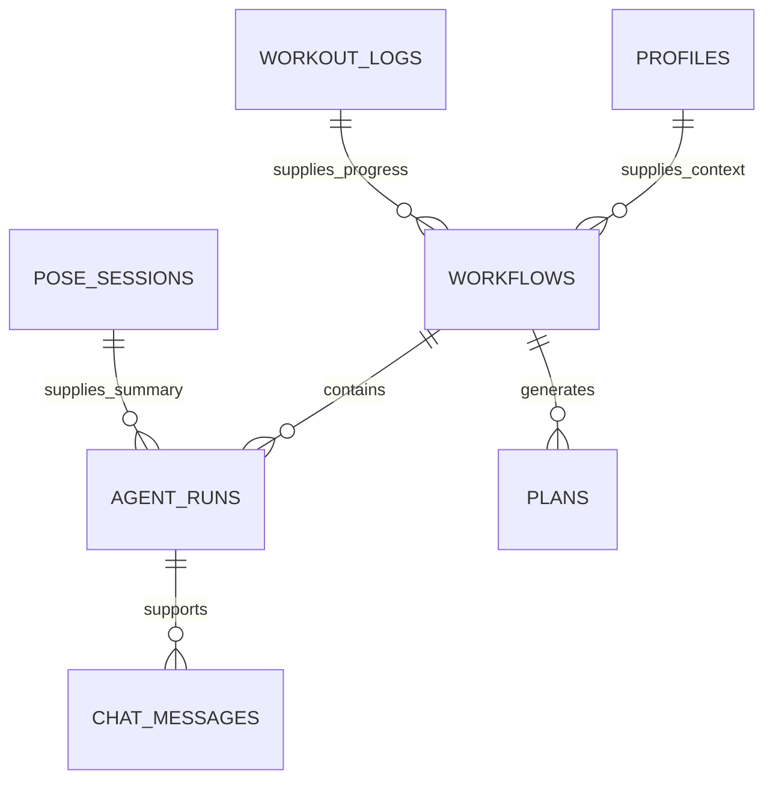

# Database and persistence

FitPilot uses Neon Postgres (or any Postgres URL in `DATABASE_URL`). `backend/app/db.py` manages connections, schema initialization, parameterized queries, and JSON serialization. There is no SQLite mode.

Use the pooled Neon URL for normal requests. Optionally set `DATABASE_URL_UNPOOLED` for schema setup. Never prefix either name with `VITE_`.

## Stored records

| Table | Records and relationships |
| --- | --- |
| `profiles` | One profile per account workspace, enforced by `id = 1`. Includes preferences, schedule JSON, food allergies, limitations, currency, and update timestamp. |
| `exercises` | Curated exercise catalog with category, equipment, difficulty, estimated duration, and instructions. Exercise names are unique. |
| `recipes` | Curated recipe catalog with ingredients, dietary tags, calories, protein, and estimated cost. Recipe names are unique. |
| `plans` | Approved plan snapshots in `content_json`, active/inactive flag, generation provenance, and optional originating `workflow_id`. |
| `workout_logs` | Completed exercises with duration, perceived effort, notes, and completion timestamp. |
| `workflows` | Coordinator execution status, shared context JSON, result JSON, and timestamps. |
| `agent_runs` | Specialist ID, input/output JSON, status, source, fallback/error details, timestamps, and optional workflow foreign key. |
| `pose_sessions` | Exercise name and derived pose summary JSON, including at most eight numerical 33-landmark snapshots. Contains no video or image bytes. |
| `model_prompts` | Prepared model request body (including messages, options and tool definitions), agent, optional agent-run ID, provider, model, time and request status. |
| `chat_messages` | User/assistant text with source, timestamp, and optional agent-run link. |

Only the explicit workflow and agent-run links are database foreign keys. Profile, pose, and progress context relationships in the diagram describe application context passed into executions. Each signed-in account owns a separate Postgres schema (`fitpilot_account_<id>`) containing these tables. The session middleware selects it for all personal API routes.

The registry holds `accounts` and `account_sessions` (see `database/auth.sql`) in the connection’s default search path (typically `public`, or a disposable test schema). The server looks up a session by its token hash. New accounts start with the submitted name and an empty history.

## Initialization

Local `scripts/dev.py` and FastAPI startup call `db.initialize()` / `auth.initialize_registry()` when not running on Vercel. Schema DDL lives in `database/schema.postgres.sql` and `database/auth.sql`. Seed catalogs use `database/seed.postgres.sql` with idempotent inserts.

On Vercel, cold starts do not create schema. Apply the SQL files on Neon before the first deploy (see `docs/DEPLOY-VERCEL.md`).

Application queries still use `?` placeholders; `db.postgres_query` rewrites them for Postgres. Timestamps are stored as UTC text for a stable API contract.

## Testing and smoke

Unit tests, `scripts/smoke.py`, and `scripts/verify.py` create disposable schemas (`test_*`) on `TEST_DATABASE_URL` or `DATABASE_URL`, then drop them. Prefer a Neon branch that is not production when sharing credentials with teammates or graders.

## Recommendation history

Chat text and specialist results are stored separately from model prompts. A prompt row records the prepared input and whether a model answered, failed, or was unconfigured. Read `model_prompts` in the account schema to inspect it. The recommender uses the saved profile, activity, and up to six recent user questions. Prompt history can contain fitness preferences and measurements. Transport headers and model-service credentials are excluded.
