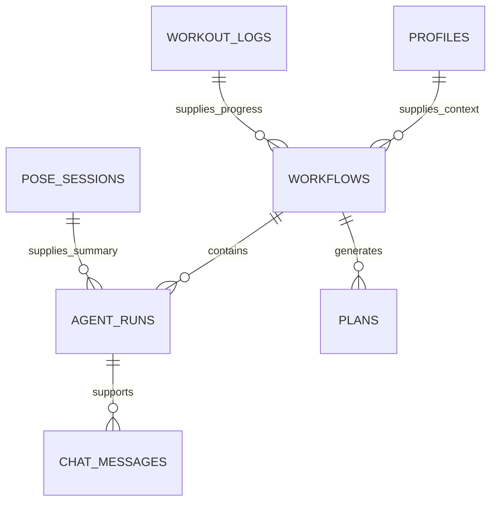

# Database and persistence

FitPilot uses Python's standard-library SQLite adapter. No separate database server is needed. `backend/app/db.py` manages connections, schema initialization, parameterized queries, and JSON serialization. The default file is `database/fitpilot.db`; set `FITPILOT_DB_PATH` to use a different local file.

Connections enable foreign keys, use write-ahead logging (WAL), and wait up to ten seconds for a locked database. WAL may create neighboring `fitpilot.db-wal` and `fitpilot.db-shm` files while the application is running.

## Stored records

| Table | Records and relationships |
| --- | --- |
| `profiles` | One local profile, enforced by `id = 1`. Includes preferences, schedule JSON, food allergies, limitations, currency, and update timestamp. |
| `exercises` | Curated exercise catalog with category, equipment, difficulty, estimated duration, and instructions. Exercise names are unique. |
| `recipes` | Curated recipe catalog with ingredients, dietary tags, calories, protein, and estimated cost. Recipe names are unique. |
| `plans` | Approved plan snapshots in `content_json`, active/inactive flag, generation provenance, and optional originating `workflow_id`. |
| `workout_logs` | Completed exercises with duration, perceived effort, notes, and completion timestamp. |
| `workflows` | Coordinator execution status, shared context JSON, result JSON, and timestamps. |
| `agent_runs` | Specialist ID, input/output JSON, status, source, fallback/error details, timestamps, and optional workflow foreign key. |
| `pose_sessions` | Exercise name and derived pose summary JSON, including at most eight numerical 33-landmark snapshots. Contains no video or image bytes. |
| `model_prompts` | Prepared model request body (including messages, options and tool definitions), agent, optional agent-run ID, provider, model, time and request status. |
| `chat_messages` | User/assistant text with source, timestamp, and optional agent-run link. |



Only the explicit workflow and agent-run links are database foreign keys. Profile, pose, and progress context relationships in the diagram describe application context passed into executions. Each signed-in account owns a separate workspace containing these tables. The session middleware selects it for all personal API routes.

The registry holds `accounts` and `account_sessions`. The server looks up a session by its token hash. With SQLite, records for a signed-in user live beside the registry in `fitpilot.db.account-<id>.db`. With Postgres they live in `fitpilot_account_<id>`. Legacy demo data stays in the original file or schema. New accounts start with the submitted name and an empty history.

## Initialization and migrations

FastAPI initializes storage on startup. `database/schema.sql` uses `CREATE TABLE IF NOT EXISTS`. The adapter checks existing column names and adds missing profile/plan columns with `ALTER TABLE`. Existing profile, plan, and workout records are retained; there is no destructive reset or automatic database deletion.

The seed script uses idempotent catalog inserts. Adding newly curated catalog entries does not require deleting the existing database. Existing historical plan JSON remains an immutable record of what was approved; it is not regenerated from the newest recipe/exercise catalog.

The original `plans.source` check constraint accepts the historical TACC/local values. An additive `execution_source` column retains richer execution provenance without rebuilding or dropping the old table. Application responses expose the appropriate source for newer records while retaining compatibility with old rows.

Schema constraints validate the basic shape of stored values. Pydantic and deterministic application checks enforce schedule, workout, catalog, dietary, equipment, and budget rules at request/workflow boundaries. The approved-plan save operation validates before deactivating the prior plan and inserts the new plan within a transaction.

## Backup

Back up the registry and each neighboring account database. For a consistent snapshot of the whole set, stop the app before doing so. The example below backs up one database using the SQLite backup API. From the project root:

```bash
backend/.venv/bin/python - <<'PY'
from pathlib import Path
import sqlite3

source = Path('database/fitpilot.db')
backup = Path('database/fitpilot.backup.db')
if not source.exists():
    raise SystemExit('Start FitPilot once to create the database.')
if backup.exists():
    raise SystemExit('Choose a new backup filename; this example preserves existing backups.')
with sqlite3.connect(source) as live, sqlite3.connect(backup) as snapshot:
    live.backup(snapshot)
print(backup.resolve())
PY
```

If you configured a custom database path, change `source` to that path. Do not copy only the main `.db` file from a running WAL database; recent changes may still be in the WAL file. For restoration, stop both services, retain a copy of the current database and its sidecars, then point `FITPILOT_DB_PATH` at the backup before restarting. Avoid replacing or deleting files while the API is using them.

## Inspecting data

The API provides profile, plan, activity, workflow, agent-run, pose-session, and chat-history read routes. For direct SQL inspection, open the database read-only:

```bash
backend/.venv/bin/python - <<'PY'
from pathlib import Path
import sqlite3

path = Path('database/fitpilot.db').resolve()
with sqlite3.connect(f'{path.as_uri()}?mode=ro', uri=True) as connection:
    for name, in connection.execute("SELECT name FROM sqlite_master WHERE type='table' ORDER BY name"):
        print(name)
PY
```

## Recommendation history

Chat text and specialist results are stored separately from model prompts. A prompt row records the prepared input and whether a model answered, failed, or was unconfigured. Read `model_prompts` in the account database to inspect it. The recommender uses the saved profile, activity, and up to six recent user questions. Prompt history can contain fitness preferences and measurements. Transport headers and model-service credentials are excluded.
