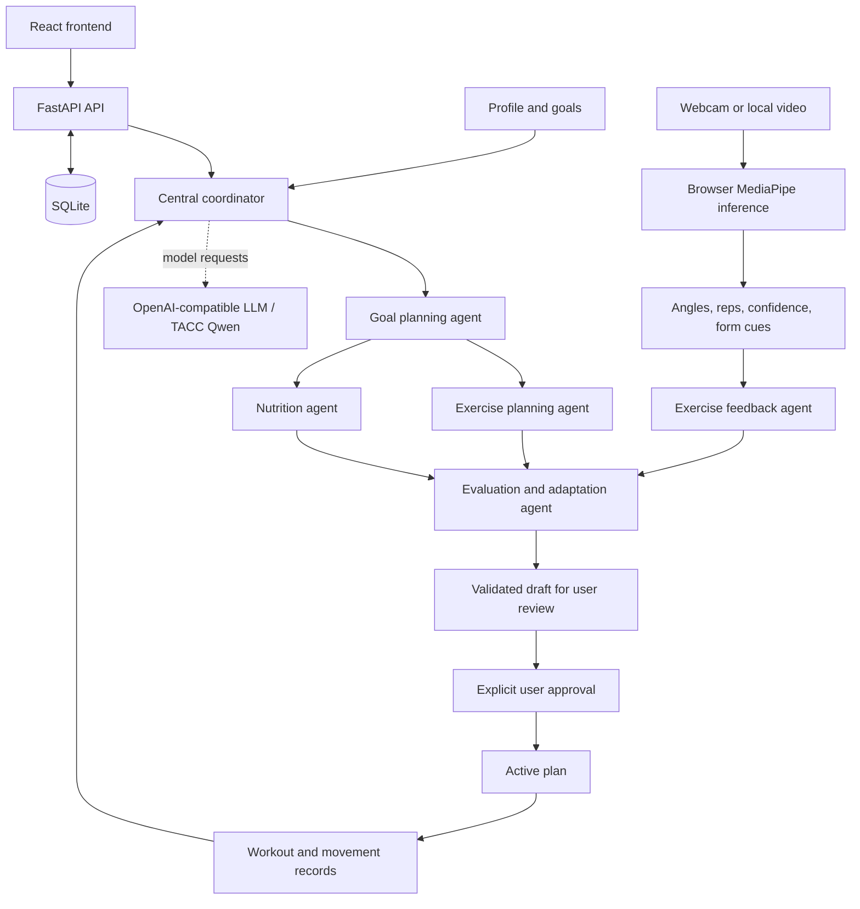

# FitPilot implementation

FitPilot is a local web application for the CSIT6000V project. The React frontend handles the dashboard, preferences, plan review, movement journal, agent workspace, and MediaPipe pose tracking. FastAPI coordinates specialized planning agents and stores user context in SQLite. A live OpenAI-compatible model is required for planning, specialists and coach chat. Deterministic helpers validate and normalize outputs; they do not substitute successful agent responses after model failure.

## Architecture

The coordinator owns workflow order and shared context: clarify impossible or vague preferences, run goal → exercise → nutrition → feedback, validate the assembled draft, then run evaluation/adaptation. Each specialized agent has its own request, structured result, provenance, and persisted execution record. If a specialist response fails deterministic checks, the coordinator allows one targeted revision for that stage before failing the run. The evaluation stage checks the combined result against stored preferences before the user can activate a plan.

Coach chat uses a tool-calling orchestrator (`app/orchestrator.py`) when a model is configured. Shared tools live in `app/tools.py`. LLM system prompts are Markdown files under `app/prompts/` that use XML tags for structure (loaded by `app/prompts/loader.py`); user/data payloads stay JSON. Browser pose estimation is a separate computer vision pipeline; it does not ask a language model to inspect video.

## Agent responsibilities

| Agent ID | Responsibility |
| --- | --- |
| `goal_planning` | Interpret the stored goal, time, schedule, equipment, experience, diet, and budget constraints into a planning brief. |
| `exercise_planning` | Build the requested weekly exercise schedule from the exercise catalog. |
| `nutrition` | Select suitable catalog recipes and calculate the estimated cost of 21 weekly servings. |
| `exercise_feedback` | Turn a saved pose session summary into movement feedback. |
| `evaluation_adaptation` | Check plan constraints and review logged progress to suggest whether to adapt future planning. |

Individual agent runs are available separately from the full planning workflow. They do not activate a plan. A draft generated by the coordinator also remains inactive until the user approves it.

## Frontend experience

| Area | Implemented behavior |
| --- | --- |
| Overview | Weekly activity statistics, completed/planned days, recent movement, meal suggestions, and a rest-day message when no workout is scheduled today. |
| My week | Coordinated plan generation, expandable specialist traces and validation checks, approval/discard controls, saved plan history, and recent draft recovery. |
| Form check | Dedicated webcam/video tracker with current measurements, explicit save/log/review controls, and persisted session history. |
| Coaching team | Architecture map, individual agent runner, optional saved pose selection, readable nested results, source labels, and recent run history. |
| Progress | Movement journal, total duration/session metrics, and effort reporting. |
| Preferences | Goal, experience, available time/equipment, exact weekday picker, diet/allergies, limitations, and USD/HKD meal budget. |
| Coach | Restored persisted conversation messages, request-in-progress state, and source attribution on answers. |

Chat and workout dialogs use keyboard focus containment, Escape dismissal, and focus restoration. Save/run errors remain visible and do not display a success state. These behaviors are implemented in source; the browser automation gate prevented visual/runtime verification in this session.

## Constraint enforcement and adaptation

Deterministic checks cover the number and uniqueness of scheduled days, the profile's selected weekdays, session limits, catalog exercise/equipment eligibility, supported dietary/allergy rules, catalog nutrition/prices, exactly 21 weekly meal servings, and estimated budget/currency.

The workout time estimate includes five minutes for warm-up/cool-down, specified timed movements or four seconds per counted repetition, and rests between sets. It is an estimate rather than a stopwatch prediction. Equipment matching handles common negation such as “no dumbbells” or “dumbbells unavailable.” Beginner profiles use beginner catalog exercises.

Supported diet rules include vegan/plant-based, vegetarian, pescatarian/pescetarian, dairy-free, gluten-free, nut-free, and high-protein (at least 20 g catalog protein per serving). Common allergy names, plural forms, and explicit “no,” “without,” “avoid,” or “X-free” phrases exclude matching ingredient terms. Ingredients are matched against the curated catalog; labels, preparation methods, and cross-contact cannot be certified. Halal, kosher, and keto requests produce an invalid draft because the catalog does not certify those constraints. Other free-text preferences are advisory and must be reviewed.

Limitations use bounded keyword exclusions: knee/hip excludes squat/lunge; shoulder/elbow/wrist excludes push-up/curl/arm circles; back excludes dead bug. This does not interpret arbitrary medical history or establish exercise suitability.

Evaluation compares logged sessions against the weekly target, reports average effort, flags an active plan that no longer meets current preferences, and surfaces available movement cues. In local planning, average weekly effort of at least 8/10 reduces the next draft's duration to 80% of the profile limit (minimum ten minutes), uses one set, and lowers repetitions for review. The approved plan changes only after the user accepts a new draft.

## Local and model execution

The model client supports a generic OpenAI-compatible `/chat/completions` API and the course's TACC Qwen service. The browser calls FastAPI; model credentials stay in the backend environment.

A configured URL is not proof of a reachable model. Health information, agent provenance, and workflow results distinguish configuration from actual inference. Missing connectivity, malformed JSON, or constraint violations are surfaced in run details and fail the run. Internal deterministic helper outputs are not live model measurements.

Execution is bounded to the configured specialist stages. Each stage makes one model request, plus at most one constraint-revision request when deterministic checks fail. A per-workflow circuit skips later model calls after a transport failure; malformed JSON or schema-invalid output fails that stage without revision. There are no open-ended agent loops.

The agents are application modules with explicit context passing and persisted execution state. They are not independent background workers or autonomous services. Running a plan workflow performs the stages for that request; it does not create a scheduled task.

## Privacy and scope

- HTTP sessions select a private account workspace before the coordinator loads profile, preferences, progress and recent questions.
- Video frames and uploaded clips stay in browser memory; the API receives derived session summaries when the user saves them.
- Saved profile details, catalog entries, plans, logs, agent inputs/outputs, and pose summaries are local database records. A pose summary can include up to eight numerical snapshots of 33 `{x,y,z,visibility}` landmarks.
- When a live LLM is enabled, the backend sends relevant profile and activity context to that configured service. Do not enter sensitive information that should not leave the device.
- MediaPipe model assets are bundled; build hooks copy WASM assets from the installed package for local serving.
- The app offers general fitness and meal suggestions. Pose rules are heuristic measurements, not medical assessment or clinical movement analysis.

## Extending the implementation

Add a new agent by defining its schema, normalization helpers, model prompt, and validation behavior in the backend registry, then expose its result in the frontend agent workspace. Include the agent in the coordinator only when the workflow depends on it.

Add a tracked exercise by defining the required landmarks, visibility rules, angle or rotation state machine, feedback cues, and summary values in the browser pose analysis module. Confirm the rep state cannot advance on missing landmarks and that exercise switching resets state.

Authentication and account isolation are implemented. Hosted deployment uses HTTPS, exact CORS origins and the PostgreSQL adapter. Webcam access outside localhost requires a secure context. See DEPLOY-VERCEL.md for the Vercel/Neon deployment path.
